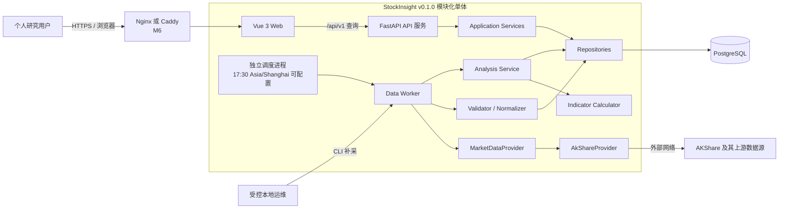
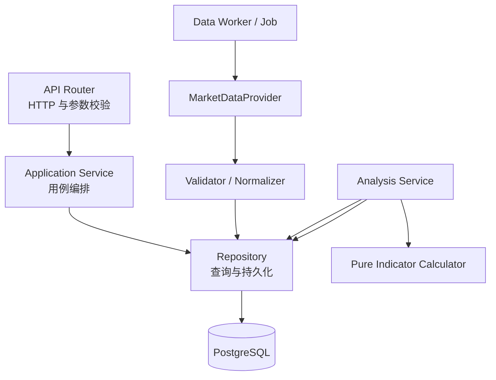
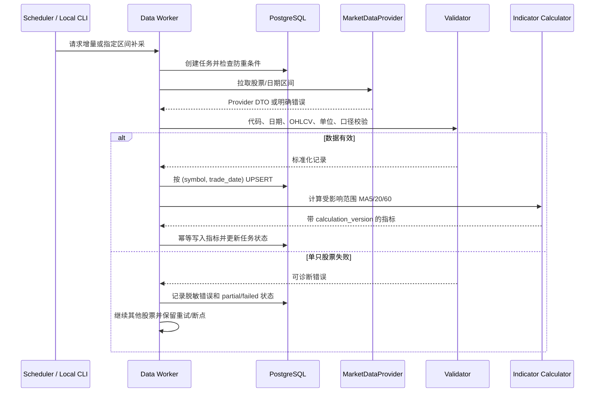
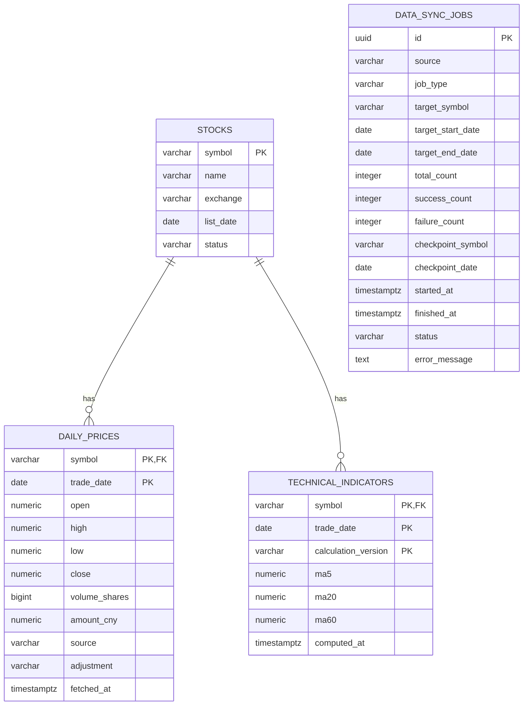

# StockInsight 系统架构

> 状态：Milestone 0 设计草案
>
> 基线：[PROJECT_PLAN.md](../PROJECT_PLAN.md)
>
> 本文描述 v0.1.0 边界，不代表组件已经实现。

## 1. 系统上下文与组件



浏览器只能访问 Web 和 API。API 的正常查询只读本地数据库，不触发外部数据采集。生产阶段数据库仅在私有网络内可达。虚线式未来部署含义由文字标注，不应把 M6 组件视为当前已完成。

## 2. 后端依赖方向



依赖必须朝内聚业务边界流动。Router 不直接引用 SQLAlchemy 查询、AKShare 或 Pandas 分析；计算器不依赖 FastAPI、数据库会话或网络。

## 3. 行情采集时序



### 3.1 调度和恢复规则

- 默认交易日 17:30（Asia/Shanghai）触发，但配置可覆盖。
- 执行前使用交易日历，并确认 Provider 当日数据已就绪。
- 任务维度的唯一/锁定策略在 M1-M2 明确，必须阻止相同范围并发重复执行。
- 网络错误采用有限次数、指数退避并带抖动的重试；结构错误和永久校验错误不盲目重试。
- 每只股票独立记录结果，批次允许 `partial`；断点按未成功股票或日期范围继续。
- UPSERT 保证重复执行不产生重复记录，但不能掩盖来源字段或口径冲突。

## 4. 数据标准化契约

内部 Provider DTO 至少包含：规范股票代码、交易日期、开高低收、成交量（股）、成交额（人民币元）、来源、获取时间、复权口径。首版复权口径固定为 `none`。

M2-01 已实现 Provider Protocol、不可变记录与批次契约；来源、接口、UTC 获取时间、复权及单位由批次统一携带，后续写库时须附加到每条日线。外部 DataFrame/字段留在 AKShare 适配层，SDK 使用私有单次子进程限制总超时；不改变上述 Worker/Validator/Repository 分层。Provider 本身只完成离线契约验收，不等于业务校验与存储成功；详见 [Provider 专题](MARKET_DATA_PROVIDER.md)。

M2-02 已实现[独立 Validator](MARKET_DATA_VALIDATOR.md)：复用 DTO，以纯函数校验代码、日期、OHLCV、单位/口径与存储范围，拒绝重复和非法行，通过后返回排序的新批次。交易日历显式注入；未提供时不能声明完整交易日验收。无网络/Web/ORM/SDK 依赖，不新增数据库结构；实际任务编排、持久化和缺日/部分失败处理仍待后续任务。

M2-03 已实现[基础信息同步与本地搜索](STOCK_PERSISTENCE.md)：StockService 在事务前完成 Provider/Validator，再通过 StockRepository 幂等 UPSERT；查询只读本地库，同快照统计/分页，返回内部 DTO。unknown/None 不覆盖已知信息，缺席不删除；整批基础信息失败回滚。不新增 Schema/API/CLI，来源与获取时间在同步收据返回；现有 stocks 表不具备逐行来源/版本审计列。

M2-04 已实现[日线区间补采持久化](DAILY_PRICE_PERSISTENCE.md)：DailyPriceService 在单股完整 Provider/Validator 后开启独立事务，检查基础信息并通过 DailyPriceRepository 复合主键 UPSERT，500 行分块仍保持整股原子性。已知单股失败继续后续股票，成功收据在提交后返回；相同业务值不重写，来源/时间/口径逐行保存，单位复用现有列。共享参数/显式日历采集前检查，空响应不代表数据完整；CLI、任务记录、自动重试/断点仍待 M2-05，无 API、Schema 或部署变化。

Validator 至少检查：

- 股票代码能无歧义映射至 SH/SZ，格式转换后仍与请求标的一致。
- 日期可解析、是预期交易日、在请求区间内且不是未来日期。
- OHLC 非负，`high >= max(open, close, low)` 且 `low <= min(open, close, high)`。
- 成交量和成交额非负；字段单位的换算在适配器中显式完成。
- `(symbol, trade_date)` 在同一批次唯一；空结果与字段缺失作为显式结果处理。
- 来源、获取时间和口径非空；fixture/mock 带测试标记，不能进入真实生产数据集。

## 5. 数据库初稿



精度、索引和检查约束见 `PROJECT_PLAN.md` 第 8 节。M1-04 已实现四张表和 `0001_initial_schema` migration；同步任务范围、股票工作项计数和恢复游标已定稿。同范围活动任务通过 PostgreSQL 部分唯一索引防重；实际采集、断点恢复及重叠范围调度锁在后续任务实现。

## 6. API 草案

| 方法 | 路径 | 主要响应 |
| --- | --- | --- |
| GET | `/api/v1/health` | API 进程存活状态与版本，不声明依赖健康 |
| GET | `/api/v1/stocks` | 分页股票摘要、查询条件和数据更新时间 |
| GET | `/api/v1/stocks/{symbol}` | 股票基础信息 |
| GET | `/api/v1/stocks/{symbol}/prices` | 有上限的日期区间 OHLCV、来源和口径 |
| GET | `/api/v1/stocks/{symbol}/indicators` | MA5/20/60、计算版本和计算时间 |
| GET | `/api/v1/system/data-status` | 最近任务、数据水位和脱敏错误摘要 |

示例统一错误结构（M1-06 已形成正式 Pydantic 模型；示例业务错误码仅作后续规划，当前只提供健康接口）：

```json
{
  "code": "invalid_symbol",
  "message": "股票代码格式无效",
  "request_id": "generated-request-id",
  "details": null
}
```

验证规则包括规范股票代码、`start_date <= end_date`、最大日期跨度、分页边界和记录上限。404 表示本地无该股票，422 表示请求参数无效，503 仅用于必要依赖不可用；本地暂无某日数据不应触发即时爬取。

## 7. 前端页面和状态

- Dashboard：本地股票数、最新交易日、最近同步状态和明显免责声明。
- StockSearch：代码/名称搜索、分页、无结果和请求错误。
- StockDetail：基础信息、数据日期/来源/口径、K 线、成交量和均线。
- DataStatus：数据水位、任务运行状态、部分失败和脱敏错误摘要。

每个异步视图都要有 Loading、Empty、Error、Success 状态；取消过期请求并避免重复提交。ECharts 只负责展示，指标值来自后端。

## 8. 部署边界

M0-M5 只面向本地开发。M6 必须由用户明确启动。生产候选拓扑是 HTTPS 反向代理连接静态前端和 API，API/Worker/Scheduler 访问私有 PostgreSQL，外部只开放 80/443（80 可仅重定向）。PostgreSQL 5432 不暴露公网，密钥由部署环境注入，备份加密且执行恢复验证。

## 9. 可观测性和错误处理

M1-06 已实现环境配置、HTTP 请求关联 ID、统一错误和 JSON 脱敏日志；使用已有 Pydantic 和标准 logging，不引入新依赖或数据库结构。test 模式只接受独立测试 URL，不回退开发库；应用启动不连接或迁移数据库。HTTP 日志只保存路由模板、状态、耗时和服务端 ID，不保存原始路径/查询/头/体；未知异常仅保留类型及代码位置。下述任务日志与业务分类随 M2/M4 实现。

- 使用结构化日志和每请求/每任务关联 ID；记录阶段、股票、日期范围、来源、耗时和结果计数。
- 禁止记录密码、Token、完整连接串、证书或不必要的原始响应。
- 区分网络/限流、数据契约、业务校验、数据库和编程错误。
- API 返回稳定错误码；后台任务保留可诊断摘要和完整的受控日志，不静默吞错。
- “任务已启动”“Provider 有响应”“数据库已写入”“前端已展示”是不同证据层，验收不能相互替代。

## 10. 架构决策边界

首版坚持模块化单体、PostgreSQL 和独立轻量调度进程。Redis、Celery、Kafka、Kubernetes、微服务和 AI 预测均没有当前需求依据。引入它们或改变数据源/复权/主键语义，必须先通过 `PROJECT_PLAN.md` 定义的架构变更流程。


## M2-05 当前实现补充

`app.jobs.cli -> CollectionRunner -> StockService/DailyPriceService -> Provider/Validator/Repository` 已实现本地采集。SyncJobRepository 用短事务更新现有 DataSyncJob，以专用 AUTOCOMMIT 会话锁串行化协作采集入口；网络和退避不占业务事务。每股独立任务、提交后 checkpoint、恢复按原范围重放，详见 [COLLECTION_CLI.md](COLLECTION_CLI.md)。基础信息仍整批原子写入；无新 Schema/依赖、HTTP 采集、前端或独立调度进程。上方未来架构图仍不代表 Scheduler/Analysis/公网部署已实现。
